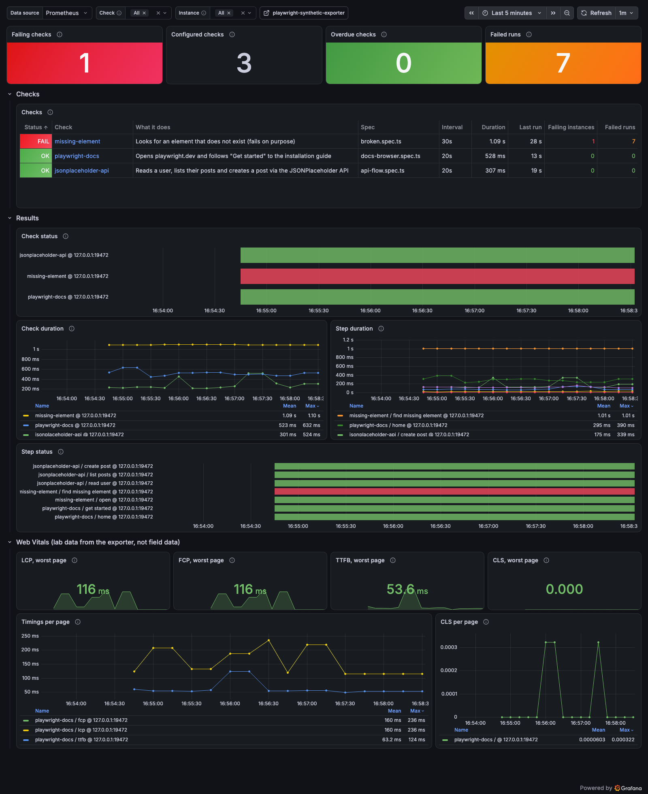

# playwright-synthetic-exporter

Run [Playwright Test](https://playwright.dev/docs/intro) specs on a schedule and
expose the results as Prometheus metrics: pass/fail, duration, the duration and
result of every `test.step`, and the Web Vitals of every page a browser check
loads.

Self-hosted synthetic monitoring for:

- **API multistep checks:** create something, wait for its effect, go on,
  clean up. Specs that only use `request` run without a browser.
- **Browser checks:** user journeys in headless Chromium, with LCP, FCP, TTFB,
  CLS, TBT and INP per page.

The checks are ordinary Playwright specs. Specs from an existing test suite or
from Checkly multistep and browser checks work after changing one import.

> Not affiliated with or endorsed by Microsoft. Playwright is a project of
> Microsoft; this exporter runs it.



## Quick start

```sh
git clone https://github.com/We-Manage/playwright-synthetic-exporter
cd playwright-synthetic-exporter/examples
docker compose up -d
```

This starts the exporter with two example checks, Prometheus with the example
alert rules, and Grafana with the dashboard on <http://localhost:3000>. The
metrics are on <http://localhost:9470/metrics>.

## Writing checks

A checks file and the specs next to it:

```yaml
# checks/checks.yml
defaults:
  interval: 5m        # how often each check runs
  timeout: 60s        # per run, Playwright's test timeout

labels:               # added to every series of every check
  env: production

checks:
  - name: checkout                # [A-Za-z0-9._-]+, unique
    description: Adds a product to the cart and opens the checkout
    spec: checkout.spec.ts        # relative to this file
    interval: 2m
    labels: { team: shop }        # added to the series of this check
    env:                          # process.env in the spec
      SHOP_USER: monitoring@example.com
      SHOP_PASSWORD: "${SHOP_PASSWORD}"   # from the exporter's environment
  - name: old-check
    spec: old.spec.ts
    enabled: false
```

`${VAR}` and `${VAR:-default}` in `env` are expanded from the exporter's own
environment, so secrets stay out of the checks file.

Specs import `test` and `expect` from `playwright-synthetic-exporter` instead
of `@playwright/test`. Everything else is plain Playwright:

```ts
// checks/checkout.spec.ts
import { test, expect } from 'playwright-synthetic-exporter';

test('checkout', async ({ page }) => {
  await test.step('open shop', async () => {
    await page.goto('https://shop.example.com/');
    await expect(page.getByRole('heading', { name: 'Shop' })).toBeVisible();
  });

  await test.step('add to cart', async () => {
    await page.getByRole('button', { name: 'Add to cart' }).first().click();
    await expect(page.getByTestId('cart-count')).toHaveText('1');
  });

  await test.step('checkout', async () => {
    await page.getByRole('link', { name: 'Checkout' }).click();
    await expect(page).toHaveURL(/\/checkout/);
  });
});
```

- Every top-level `test.step` becomes a step in the metrics. Name steps after
  what the user does; nested steps stay inside their parent.
- One spec file per check; all tests in it have to pass.
- Wait for asynchronous effects with `expect.poll` or `expect(...).toPass()`.
- Clean up what the check creates in `finally` or `test.afterAll`, and remove
  leftovers of earlier runs at the start: a run can die halfway.
- There are no retries. A failed run is a result; run the exporter in more
  than one place for a second opinion.

`examples/checks/` has a browser check and an API multistep check.

### Coming from Checkly

Checkly multistep and browser checks are Playwright specs. Replace
`import { test, expect } from '@playwright/test'` with
`import { test, expect } from 'playwright-synthetic-exporter'`, move
environment variables into `env`, and add the check to `checks.yml`.

## Running

The image contains Node, Chromium and the exporter. Mount your checks over
`/app/checks`; it has to stay below `/app` so the specs find their imports.

```sh
docker run -d --name synthetic --init --shm-size 512m --memory 2g \
  -v "$PWD/checks:/app/checks:ro" -v synthetic-data:/data \
  -e SHOP_PASSWORD -p 127.0.0.1:9470:9470 \
  ghcr.io/we-manage/playwright-synthetic-exporter:edge
```

- `--init` reaps the browser processes of finished runs.
- `--shm-size`: Chromium needs more shared memory than Docker's default 64 MB.
- Checks run one at a time. A browser check takes about 1 GB of memory while
  it runs; an API check hardly any.
- Prometheus scrapes `/metrics`. Scrapes only read the last results, so any
  scrape interval works. VictoriaMetrics, vmagent, Telegraf and Elasticsearch:
  see [docs/integrations.md](docs/integrations.md).

Options, as flags or environment variables:

| Flag | Environment | Default | |
|---|---|---|---|
| `--config` | `PSE_CONFIG` | `checks/checks.yml` | checks file, YAML or JSON |
| `--data-dir` | `PSE_DATA_DIR` | `/data` in the image | traces and screenshots of failed runs |
| `--listen` | `PSE_LISTEN` | `:9470` | metrics address |
| `--once` | | | run every check once, print the results, exit 1 on failure |
| `--check <name>` | | | only this check, may be repeated |

Without Docker: `npm ci`, `npx playwright install --with-deps chromium`,
then `node src/runner.mjs --config checks/checks.yml`.

### Several locations

Run one exporter per location and scrape all of them; `instance` tells them
apart. A check that fails from one location only is usually that location's
network. The example alert rules therefore alert when a check fails
everywhere.

## Lightweight API flows with hurl

A flow that is just a chain of requests does not need Node or a browser:
[`hurl/`](hurl/) has `hurl-probe`, which runs a [hurl](https://hurl.dev) file
behind script_exporter and reports duration and result per request, with the
same `index` and `step` labels as here.

## Metrics

Every series carries `check` and the labels from the checks file.

| Metric | Extra labels | |
|---|---|---|
| `synthetic_pw_check_info` | `spec`, `interval`, `timeout`, `description` | 1 per configured check |
| `synthetic_pw_success` | | 1 if every test passed on the last run |
| `synthetic_pw_duration_seconds` | | test duration of the last run |
| `synthetic_pw_step_duration_seconds` | `index`, `step` | per top-level `test.step` |
| `synthetic_pw_step_success` | `index`, `step` | per top-level `test.step` |
| `synthetic_pw_last_run_timestamp_seconds` | | end of the last run |
| `synthetic_pw_interval_seconds` | | configured interval |
| `synthetic_pw_runs_total` | `result` (`success`, `failure`) | runs since start |
| `synthetic_pw_web_vital_seconds` | `page`, `metric` (`lcp`, `fcp`, `ttfb`, `tbt`, `inp`) | last run |
| `synthetic_pw_cls` | `page` | cumulative layout shift, last run |

`index` is the position of the step in the run (`01`, `02`, ...), so panels
and tables can show the steps in execution order.

Web Vitals are measured with Google's [web-vitals](https://github.com/GoogleChrome/web-vitals)
library inside the page. They are lab values from the exporter's location and
network, not the field data Google ranks on. TBT (long tasks beyond 50 ms)
stands in for INP; INP itself only appears after interactions in the spec.
`page` is the path without the query string.

## Dashboard

[`dashboards/playwright-synthetic.json`](dashboards/playwright-synthetic.json)
works with any Prometheus-compatible data source (Prometheus, VictoriaMetrics,
Mimir, Thanos), also when Telegraf collects the metrics
([integrations](docs/integrations.md)). Import it in Grafana under *Dashboards → New → Import*. It
shows:

- failing, overdue and failed runs at a glance
- a list of all checks with what they do, status, duration, last run and
  failing instances; a click on a check filters the dashboard
- status, duration and steps per check and instance, so the failing step
  is visible
- Web Vitals with Google's thresholds

## Alerts

[`examples/prometheus/alerts.yml`](examples/prometheus/alerts.yml): a check
fails on every instance, a check is overdue, an exporter is down.

## When a check fails

The log has one JSON line per run with the first lines of the error:

```json
{"check":"checkout","ok":false,"duration":4.2,"wall":5.1,"error":"Error: expect(locator).toBeVisible() failed | Locator: getByTestId('cart-count') | Expected: visible"}
```

The data directory keeps `trace.zip`, a screenshot and the error context of
the last failed run in `/data/<check>/`. Open the trace with
`npx playwright show-trace trace.zip` or on <https://trace.playwright.dev>.

Run a single check by hand:

```sh
docker exec -it synthetic node /app/src/runner.mjs --once --check checkout
```

## License

[MIT](LICENSE)
